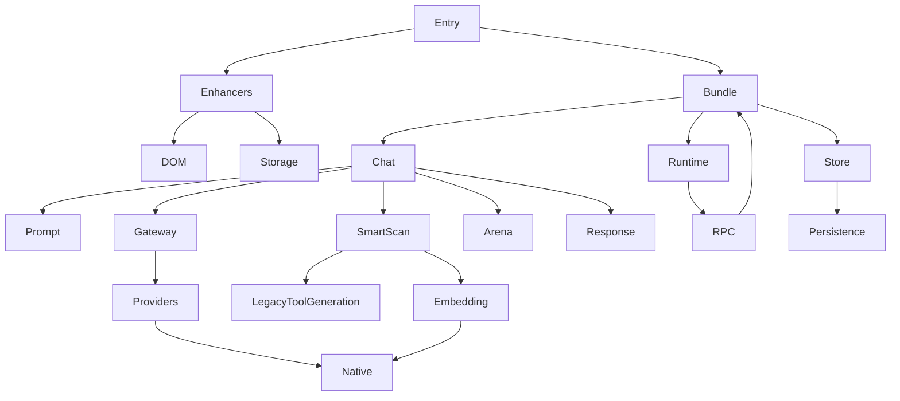

# R1.1 | Bản đồ quan hệ phụ thuộc

> Baseline: `398165a0954f98de6c3553f32e6af2308c963260` (main, ứng dụng 1.3.6). Phân tích tĩnh; chưa chạy build/AST/runtime. Quyết định kiến trúc là đề xuất cho Phase 1, chưa thay đổi repository.

## As-is (quan hệ logic, không phải toàn bộ import graph)

## Edge register
| From | To | Mechanism | Đích |
|---|---|---|---|
| Entry | M5–M8 assets | import sau copy | import source |
| Build | legacy + 12 transforms | string patch | temporary adapter rồi xóa |
| Conversation | state/prompt/scan/gateway/arena/response | deps.* | typed ports |
| Prompt | turn-policy, legacy xd | import + callback | prompt core owned |
| Smart Scan | embedding, legacy Ks/cl | callbacks | embedding + generation ports |
| Generation gateway | 4 adapters | import | registry |
| Model test | DOM/storage/global bridge | selector/global | connection service |
| AI Studio | Capacitor, localStorage, log global | platform globals | platform port, config snapshot |
| Session snapshot | Arena normalization | import | public contract |
| Runtime guard | runtime-state + DOM | import + watchdog | state-driven UI |
| Runtime fragments | shared scope, root API | string assembly | modules + explicit facade |
| Runtime | host | postMessage RPC | versioned validated contract |
| Native embedding | ONNX, LiteRT | Capacitor | native adapter |
| JSZip | index-yS4Vru8B.js | static import | preserve until vendor migration |

Kiểm tra tiếp: AST scope graph, dynamic import, string RPC, public global assignment, event registrations, CSS động, Android annotation/plugin names. Không dùng grep đơn thuần để chứng minh reachability.
