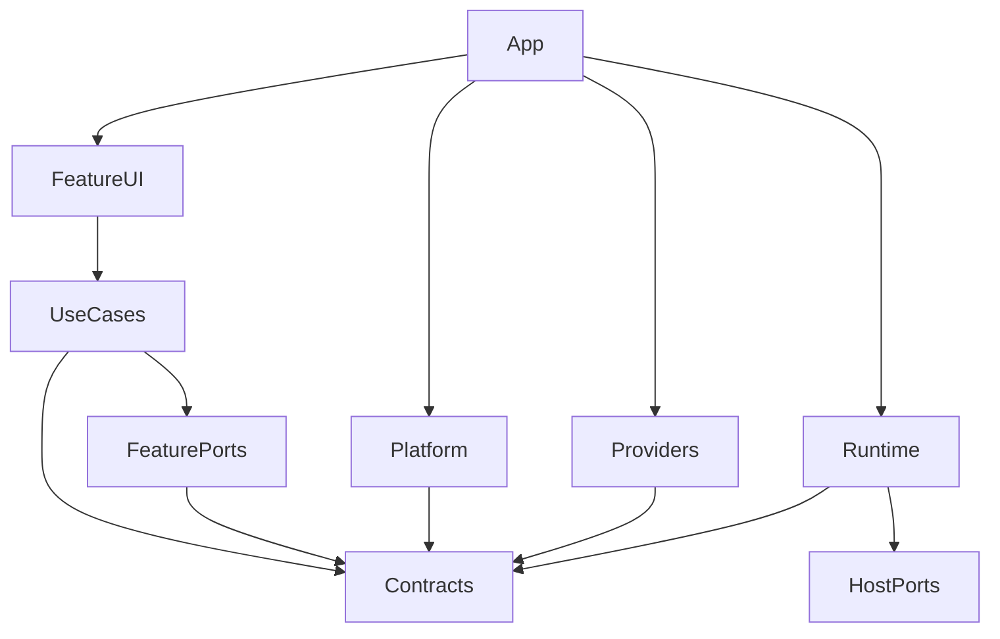

# R1.3 | Kiến trúc đích

> Baseline: `398165a0954f98de6c3553f32e6af2308c963260` (main, ứng dụng 1.3.6). Phân tích tĩnh; chưa chạy build/AST/runtime. Quyết định kiến trúc là đề xuất cho Phase 1, chưa thay đổi repository.

## ADR-001: Modular monolith, feature-first
Giữ React/Capacitor, chuyển dần sang source ESM và TypeScript khi boundary ổn định. Không bắt buộc chuyển tất cả file TS đồng thời. Vite là lựa chọn đề xuất cho build, không phải yêu cầu đã được triển khai. Không redesign, không tối ưu hiệu năng chuyên sâu.

```text
src/
  app/                 # composition root, entry, routing, shell
  core/                # contracts thật sự dùng chung, errors, primitives
  features/
    connections/       # settings, profiles, catalog use cases
    chat/              # conversation, messages, streaming
    arena/             # comparison state & use cases
    characters/        # import/edit/catalog
    personas/
    presets/
    prompts/
    world-info/        # lorebook, scan, embedding submodule
    variables/         # scopes, initial, smart state
    rpg/
    tools/             # summary, story, co-pilot, action suggestion
    regex/
    media/             # audio / HUD-related domain
  providers/           # registry, contracts, Gemini, OpenRouter, Proxy, AI Studio
  runtime/             # host bridge, iframe entry, compatibility facade
  platform/            # browser storage/network, Android adapters, export
  ui/                  # shared components/styles, giữ hình thức hiện tại
  diagnostics/         # observation, redaction, bounded logs
android-native/        # Java (giữ path đến khi migration platform được duyệt)
public/                # static vendor/compat assets theo deployment
build/                 # chỉ còn tooling cần thiết
tests/                 # contracts, unit, integration, E2E, fixtures
docs/architecture/
dist/                  # generated, không sửa tay
```
Không tạo thư mục rỗng hàng loạt. Feature có UI/model/service riêng khi cần, không bắt buộc ba tầng cho module nhỏ. Tên trên là ownership target, có thể gộp module nhỏ không làm mất ranh giới.


App composition cung cấp implementation cho ports; mũi tên là dependency compile-time, không mô tả runtime call. Domain không import UI/platform. Runtime iframe có build entry riêng, chỉ facade được phép publish globals tương thích. Host adapters kiểm tra context và dispatch vào use case; không yêu cầu rewrite sandbox đồng thời.

## ADR-002: One owner per business capability
Connections sở hữu cấu hình nghiệp vụ, Providers sở hữu wire protocol, platform/storage sở hữu IO, feature/chat sở hữu history, runtime sở hữu compatibility ABI, diagnostics chỉ quan sát. Model catalog refresh không reload. Credential snapshot explicit. Chat/tool/arena/test dùng cùng provider routing nhưng giữ khác biệt sampler/purpose theo capability.

## ADR-003: Deployment
Build từ source tạo dist, vendor/static được copy hoặc bundled có manifest. Netlify hiện publish dist; Android workflow build dist rồi Capacitor sync; kiểm tra static root/portable distribution trước bỏ generated assets khỏi Git. Không xóa legacy đến khi feature parity và CI gate đạt. Lockfile và Node version thống nhất; package manifest đầy đủ. Giữ build cũ trong thời gian migration với sunset gate, không duy trì hai app lâu dài.
